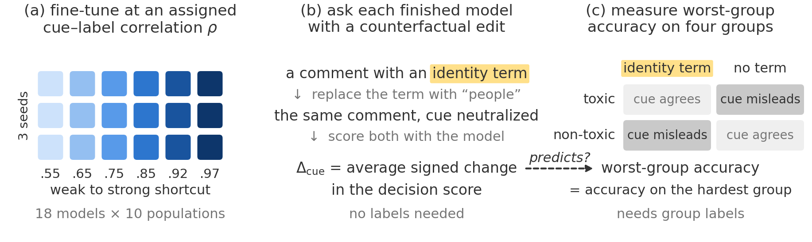

# Ask the Model: Counterfactual Cue Reliance Predicts Worst-Group Failure and Targets Repair

Prakhar Gupta, Terry Jingchen Zhang, Florent Draye, Bernhard Schölkopf, Zhijing Jin

<!-- Add the paper link here once it is public. -->

<p align="center">
  
</p>

Fine-tuned models often lean on shortcut cues, such as an identity term that happens to
co-occur with toxic labels during training. We measure that reliance directly. We edit the
cue out of held-out inputs and record how far the model's decision score moves, a quantity
we call Δcue. Measuring it needs no labels.

We fine-tuned 486 small language models on CivilComments and Bias-in-Bios with a known
cue–label correlation. Models with higher Δcue have lower worst-group accuracy, and Δcue
helps decide which models to repair with LEACE. This repository has the code and the logs
of every trained model.

## Setup

```bash
git clone https://github.com/prakharg55/cue_reliance.git
cd cue_reliance
pip install -r requirements.txt
```

Tested with Python 3.12. Run all commands from the repository root.

## Reproducing the paper

Every trained model left a log in `logs/` with the measurements the analyses need, so every
figure and table, and almost every number in the text, can be regenerated on a CPU without
training anything:

```bash
bash reproduce.sh
```

This takes about five minutes. It rewrites `results/` and `figures/`, and `git diff`
should show no changes afterwards.

| In the paper | Script in `analysis/` |
|---|---|
| Figures 1 to 6 | `fig1_overview.py` to `fig6_linear_control.py`, one per figure |
| Tables 1, 8 and 10 | `repair_analysis.py` |
| Table 2 | `repair_targeting.py` |
| Table 3 | `validity_controls.py` |
| Table 4 | `fixed_effects.py` |
| Tables 5 and 6 | `primary_analysis.py` |
| Table 7 | `equivalence_bounds.py` |
| Table 9 | `repair_allocation.py` |
| Table 11 | `robustness_and_epochs.py` |
| Table 12 | `public_classifiers.py` |
| Other numbers in the text | `canonical_numbers.py`, `supporting_analyses.py` |

Each script prints its results, and `results/<script>.txt` keeps that output exactly as it
was used in the paper. Two outputs cannot be regenerated from the logs. The data audits in
Appendix B need the datasets, so they live in `training/`, and the compute totals in
`results/compute_audit.txt` come from the cluster's job records.

## Training models

Training needs a GPU. The datasets are not redistributed here, so first rebuild them from
their public releases, and download the base model you want to train:

```bash
pip install -r requirements-train.txt
export HF_HOME=$PWD/hf_cache          # the training scripts read models from here
hf download Qwen/Qwen2.5-0.5B
python training/prepare_civil.py      # writes data/civil_pool.json
python training/prepare_bios.py       # writes data/bios_pool.json
python training/train_civil.py --model qwen --rho 0.97 --seed 0
```

The other base models are Qwen/Qwen2.5-1.5B, Qwen/Qwen2.5-0.5B-Instruct,
EleutherAI/pythia-410m, EleutherAI/pythia-1.4b and allenai/OLMo-2-0425-1B (see `MODELS` in
`training/common.py`).

Each run fine-tunes one model with LoRA, measures it, and prints the lines that the analysis
scripts read from `logs/`. A run takes about 8 minutes on one A100 GPU, and the whole study
took about 83 GPU-hours. We did not keep the trained weights.
[`logs/README.md`](logs/README.md) lists which script produced which logs.

## Repository layout

```
analysis/    statistics and figures, computed from the logs (CPU)
training/    data preparation, fine-tuning and measurement (GPU)
logs/        one log per trained model
results/     saved output of every analysis script
figures/     the figures in the paper
```
